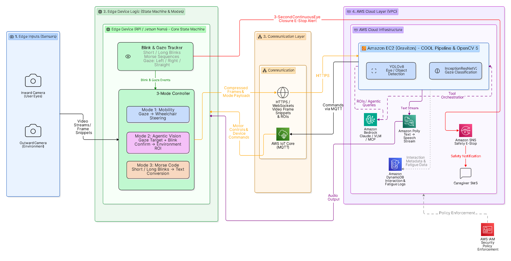
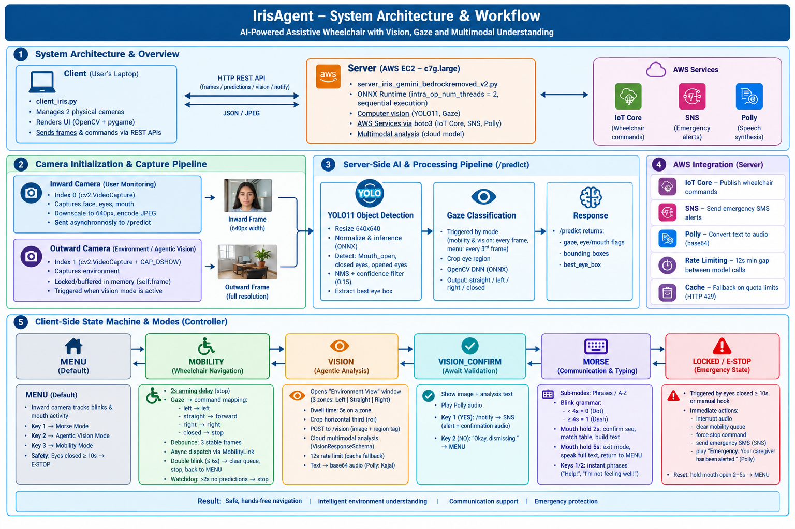
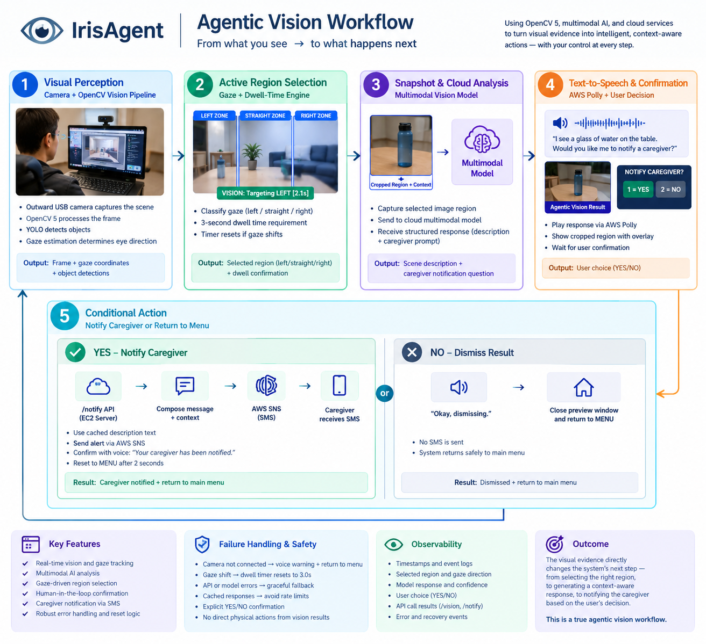

# IrisAgent: Low-Cost, Cloud-Accelerated Assistive Agent

**OpenCV AI Competition 2026, Final Submission**
**Team:** IrisAgent (Individual participation)
**Author:** Samsthidhaa Sree S

IrisAgent turns a standard dual-camera setup into a hands-free assistive system. Users with severe motor disabilities (ALS, spinal cord injuries, locked-in syndrome, stroke, neuromuscular degeneration) can steer a mobility device, communicate through text-to-speech, and interact with their room using only their eyes, blinks, and mouth movements.

---

## Table of Contents

1. [Problem Statement](#1-problem-statement)
2. [Solution Overview](#2-solution-overview)
3. [Target Users and Beneficiaries](#3-target-users-and-beneficiaries)
4. [System Architecture](#4-system-architecture)
5. [Operating Modes and Safety](#5-operating-modes-and-safety)
6. [Agentic Vision Workflow](#6-agentic-vision-workflow)
7. [OpenCV 5 and COOL Implementation](#7-opencv-5-and-cool-implementation)
8. [Benchmarks and COOL Evidence](#8-benchmarks-and-cool-evidence)
9. [Model Accuracy](#9-model-accuracy)
10. [Repository Structure](#10-repository-structure)
11. [Setup and Running](#11-setup-and-running)
12. [Limitations and Failure Cases](#12-limitations-and-failure-cases)
13. [Responsible Use, Privacy, and Security](#13-responsible-use-privacy-and-security)

---

## 1. Problem Statement

Millions of people worldwide live with severe motor disabilities that remove physical mobility and independent communication. Existing assistive technologies are either:

- **Prohibitively expensive**, requiring specialized medical hardware that can cost thousands of dollars, or
- **Overly rigid**, relying on hardcoded menus that cannot adapt to real-world environments.

## 2. Solution Overview

IrisAgent is a low-cost, cloud-accelerated assistive agent. It is powered by **OpenCV 5** and **Cloud-Optimized OpenCV (COOL)** running on **AWS Graviton3**. It provides:

- Wheelchair steering from gaze direction
- Text-to-speech conversation from blink-based Morse input
- Environment interaction (for example, smart home control or object disambiguation) through a multimodal reasoning loop
- Automated safety override (E-Stop) for emergencies
- Digital interaction logs for caregivers

## 3. Target Users and Beneficiaries

**Primary beneficiaries:** Paralyzed individuals, ALS patients, stroke survivors, and people with severe neuromuscular degeneration.

**Secondary beneficiaries:** Caregivers, rehabilitation clinics, and families who need remote visibility, safety monitoring (E-Stop alerts), and less stressful caregiving.

## 4. System Architecture

IrisAgent uses an integrated closed-loop edge-to-cloud architecture designed for low-latency determinism, data privacy, and agentic orchestration.



*Fig 1.0: End-to-End Edge-to-Cloud Hybrid System Architecture.*



*Fig 2.0: IrisAgent Workflow Diagram.*

The data and logic flow runs through six phases:

### Phase 1: Edge Sensing and Multi-Modal Input Acquisition
- The **inward-facing camera** captures the user's face and eyes.
- The **outward-facing USB camera** captures the physical room.

### Phase 2: Local Edge Processing and 3-Mode State Routing
- The **Blink and Gaze Tracker** isolates eye landmarks, measures blink duration (short blinks, long blinks, and Morse sequences), and classifies gaze as Left, Right, or Straight.
- The **3-Mode Controller** routes data based on the active mode (see [Section 5](#5-operating-modes-and-safety)).

### Phase 3: Secure Edge-to-Cloud Transport
- Structured mode payloads, compressed video frame snippets, and targeted Regions of Interest (ROIs) are sent to the cloud over encrypted HTTPS.

### Phase 4: Cloud-Optimized Inference (COOL and OpenCV 5 Pipeline)
- Data arrives at an **Amazon EC2 Graviton3** instance running the COOL-optimized OpenCV 5 runtime, which executes optimized computer vision models.

### Phase 5: Agentic Reasoning, Voice Generation, and Safety Dispatches
- **Agentic Vision Path:** Cropped ROIs go to a cloud multimodal reasoning model, which interprets user intent and maps it to an action.
- **Voice Generation Path:** Text is sent to **Amazon Polly**, which returns audio streams to the edge.
- **Safety E-Stop Path:** Continuous eye-closure interrupts trigger **Amazon SNS** to text caregivers.
- **Logging Path:** Non-video interaction metadata and fatigue metrics are written asynchronously to **Amazon DynamoDB**.

### Phase 6: Physical Actuation and Real-World Execution
- Resolved instructions are designed to travel via **AWS IoT Core** to edge hardware (wheelchair motors or smart plugs), with **Amazon Polly** providing auditory confirmation.
- **Demo note:** AWS IoT Core is **not implemented** in the current demo. The laptop acts as the client.

## 5. Operating Modes and Safety

| Mode | Trigger | Behavior |
|---|---|---|
| **Mode 1: Mobility** | Gaze (Left, Right, Straight) | Gaze vectors map directly to immediate wheelchair directional commands. |
| **Mode 2: Agentic Vision** | Gaze target held and confirmed | Extracts a targeted Environment ROI and runs the perception-decision-action loop (see [Section 6](#6-agentic-vision-workflow)). |
| **Mode 3: Morse Code** | Short and long blinks | Blinks are translated locally into text, which is spoken aloud. |
| **Safety: E-Stop Override** | Continuous eye closure ≥ 10 seconds | Bypasses normal mode logic and triggers a high-priority system interrupt, which sends an SNS alert to caregivers. |

## 6. Agentic Vision Workflow

IrisAgent runs a multi-step **Perception, Decision, Action** loop. Visual evidence changes what the system does next, which ends in real-world tool execution and human validation. This is different from a passive chatbot that only describes a picture.



*Fig 3.0: The Agentic Vision Perception-Decision-Action Loop.*

1. **Perception (Environmental Scan):** The user enters VISION mode, which opens a dual-window "Environment View." The outward camera feed is split into three zones: **Left**, **Straight (Center)**, and **Right**.
2. **Decision (Dwell-Time Selection):** The user selects a zone by gazing at it. Holding gaze on a zone for **5.0 seconds** (`VISION_DWELL_TARGET_S`) triggers selection without any manual click.
3. **Action and Tool Orchestration:**
   - The system crops the matching horizontal third of the outward frame (ROI) and sends it to the cloud backend.
   - The multimodal reasoning model identifies the main object, infers intent, and proposes an action (for example, *"I see a water bottle. Would you like me to notify a caregiver?"*).
4. **Human-in-the-Loop Validation (`VISION_CONFIRM`):**
   - The system shows the snapshot with the analysis overlay and plays the question via Amazon Polly.
   - **Key 1 (YES):** Compiles a caregiver alert, sends it via Amazon SNS as an SMS, and plays hardware confirmation audio.
   - **Key 2 (NO):** Dismisses the action and returns the user to the idle MENU.

## 7. OpenCV 5 and COOL Implementation

| Item | Value |
|---|---|
| Cloud / Region | AWS EC2, `ap-south-1` (Mumbai) |
| Instance | `c7g.large`, AWS Graviton3, 2 vCPUs, 4 GiB RAM, 50 GiB gp3 |
| Architecture | aarch64 / Arm64 |
| Product | Cloud Optimized OpenCV for Graviton3 |
| COOL package release | `COOL-graviton3-v3-prod-xcqopwa7u5zdu` |
| Delivery method | Amazon Machine Image (AMI) |
| COOL build | OpenCV 4.12.0-dirty; module under `/opt/cool/python_3.12/site-packages/` |
| Standard baseline | `opencv-python-headless` 4.12.0.88 ARM64 wheel; isolated venv at `/tmp/irisagent-standard-412` |

**Key technical components:**

- **Graph-based DNN engine:** Uses the OpenCV 5 DNN module to run optimized ONNX models natively, without heavy third-party runtimes such as full PyTorch in production.
- **Inward camera (eye, face, and mouth state):** YOLO11 (`eye_gaze_blink_mouthopen_best.onnx`) combined with a gaze classification model (`eye_gaze_model_2.onnx`), both run through OpenCV DNN / ONNX Runtime.
- **Outward camera:** Real-time object tracking and ROI cropping to find interactable items in the room.
- **Low-latency edge execution:** Frame capture, bounding-box visualization, and state-machine tracking use native Python OpenCV APIs.

## 8. Benchmarks and COOL Evidence

All benchmarks ran on an AWS Graviton3 `c7g.large` instance (2 vCPUs, 4 GiB RAM, `ap-south-1`). They compare COOL's OpenCV 4.12.0 build against a standard OpenCV 4.12.0 ARM64 wheel.

### 8.1 Stage-Level Preprocessing and Postprocessing Microbenchmarks

**Method:** 10 warm-up iterations, then 100 measured iterations per run, across 5 alternating-order trials, using a 640×480 test image (`irisagent_test_frame.jpg`).

| Metric | COOL OpenCV 4.12.0 | Standard OpenCV 4.12.0 | Observation |
|---|---|---|---|
| Preprocessing: mean latency | 1.8786 ms | 2.9291 ms | **COOL 35.9% lower (faster)** |
| Preprocessing: mean of run medians | 1.8547 ms | 3.0017 ms | **COOL 38.2% lower** |
| Postprocessing + NMS: mean latency | 0.2587 ms | 0.1990 ms | COOL 30.0% higher (slower) |
| Detection output | 2 detections | 2 detections | Exact output equality in all trials |

*Table 2.0: Stage-level preprocessing and postprocessing microbenchmarks.*

### 8.2 End-to-End Server Integration Benchmark

**Method:** End-to-end HTTP benchmarking on localhost against the `/predict` endpoint (`mode=vision`), with 10 warm-up requests and 100 measured requests.

| Metric | Baseline Server (Port 5000) | COOL Hybrid Server (Port 5001) | Change |
|---|---|---|---|
| Successful requests | 100/100 | 100/100 | 100% success rate |
| Mean latency | 580.63 ms | 503.24 ms | 13.33% lower |
| Median latency | 579.16 ms | 503.97 ms | 12.98% lower |
| P95 latency | 600.85 ms | 510.36 ms | 15.06% lower |
| Minimum latency | 572.70 ms | 496.32 ms | 76.38 ms lower |

*Table 3.0: End-to-end server integration benchmark.*

**Honest note:** COOL improved preprocessing and end-to-end latency. Postprocessing + NMS was slightly slower with COOL in the microbenchmark (0.26 ms vs. 0.20 ms). The absolute difference is small, and the detection output was identical.

## 9. Model Accuracy

### 9.1 YOLO11 Detection Model
- **Classes evaluated:** Eye state (open and closed), mouth status (`Mouth_open`), and face tracking.
- **Key metric:** mAP50 of **85%**.


*Fig 4.0: YOLOv11n training results.*


*Fig 5.0: Confusion matrix of the YOLOv11 model.*

### 9.2 Gaze Classification Model (Inception-ResNetV2)
- **Classes:** Straight, Left, Right, Closed.
- **Key metric:** Overall accuracy of **90%**, which supports stable real-time wheelchair control and 5-second dwell selection.


*Fig 6.0: Confusion matrix of the Inception-ResNetV2 gaze model.*

## 10. Repository Structure

```
IrisAgent/
├── README.md                              # This file
├── server/                                # Cloud backend (FastAPI/Flask, /predict endpoint)
├── client/                                # Edge client (camera capture, state machine, UI)
├── models/                                # ONNX models
│   ├── eye_gaze_blink_mouthopen_best.onnx # YOLO11 eye/mouth detection
│   └── eye_gaze_model_2.onnx              # Gaze classification
└── IrisAgent_COOL_Award_Evidence/         # Competition evidence
    ├── images/                            # Figures referenced in this README
    ├── benchmarks/                        # Benchmark scripts and raw results
    └── report/                            # Final competition report
```

> Update the folder names above to match your actual repository layout.

## 11. Setup and Running

### Prerequisites
- Python 3.12
- A standard dual-camera setup (inward-facing eye camera and outward-facing room camera)
- AWS account with access to EC2 (`ap-south-1`), Polly, SNS, and DynamoDB
- The COOL AMI (`COOL-graviton3-v3-prod-xcqopwa7u5zdu`) or the standard OpenCV 4.12.0 ARM64 wheel for baseline comparison

### Steps

```bash
# 1. Clone the repository
git clone <your-repo-url>
cd IrisAgent

# 2. Start the cloud server (on the EC2 Graviton3 instance)
cd server
pip install -r requirements.txt
python <server_entry_file>.py

# 3. Start the edge client (on the laptop or edge device)
cd ../client
pip install -r requirements.txt
python <client_entry_file>.py
```

Replace `<server_entry_file>` and `<client_entry_file>` with your actual file names.

### Configuration
- Set the cloud server URL in the client config so it points to your EC2 instance.
- Configure AWS credentials with least-privilege IAM policies (see [Section 13](#13-responsible-use-privacy-and-security)).
- Key constant: `VISION_DWELL_TARGET_S = 5.0` (dwell time for zone selection).

### Stopping the Instance
Stop the EC2 instance when it is not in use or after a demo to reduce security exposure and cost:

```bash
aws ec2 stop-instances --instance-ids <your-instance-id> --region ap-south-1
```

## 12. Limitations and Failure Cases

**Scope of evaluation**
- The end-to-end benchmark is a single controlled test using a fixed test image.
- Live multi-frame video streams under concurrent multi-user load have not been tested yet and remain future work.

**Environmental dependencies**
- Tracking accuracy can drop in very low light, strong backlight, or direct glare on the user's face.
- Stable performance needs adequate ambient room lighting.

**API rate limiting and fallback**
- To avoid HTTP 429 quota errors from the cloud multimodal backend during rapid polling, the server enforces a local **12-second minimum window** and returns cached contextual speech.
- If a 429 still occurs, a fallback routine responds safely without crashing the client state machine.

**Latency and accuracy goals**
- Stage-level vision processing: under 50 ms (met).
- Blink classification accuracy: above 95% (met).

**Hardware**
- IoT Core integration is not implemented in the current demo.

## 13. Responsible Use, Privacy, and Security

- **Zero-persistence policy:** All frames from both cameras are processed in volatile RAM and never written to disk.
- **IAM least privilege:** Access to IoT Core, SNS, DynamoDB, and Polly uses dedicated IAM roles. A custom non-admin policy limits backend scripts to the permissions they need, such as publishing to designated SNS topics or writing telemetry to DynamoDB.
- **Instance lifecycle:** The Graviton3 EC2 instance is stopped when not in use or after live demos, which reduces attack surface and cost.
- **Resource tagging:** All AWS resources (EC2, IAM policies, SNS topics, DynamoDB tables) use tags such as `Project=IrisAgent` for cost tracking, governance, and auditing.
- **Encryption in transit:** Microservice communication within AWS is protected with TLS 1.3, and edge-to-cloud transport uses encrypted HTTPS.

---

## License

<!-- Add your license here, e.g. MIT -->

## Acknowledgements

Built for the **OpenCV AI Competition 2026**. Thanks to the OpenCV team and the COOL program for the optimized Graviton3 runtime.
